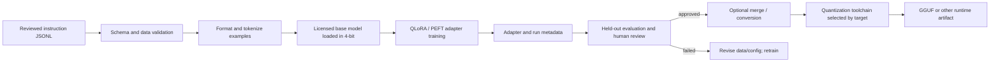

# Open-Source LLM Fine-Tuning & Quantization Pipeline

A reproducible QLoRA instruction-tuning starter for CUDA/Linux environments. It validates JSONL records, loads a licensed base model in 4-bit, trains a LoRA adapter, and saves the adapter plus run metadata.

## Workflow

## Current implementation

The pipeline includes JSONL validation, deterministic train/validation splitting, 4-bit model loading, response-only adapter training, validation loss/perplexity, held-out perplexity and exact-match evaluation, and GGUF/AWQ export entry points. Export requires separately installed compatible toolchains and validation on the intended runtime. See the deployment guide for exact commands.

## Requirements

Use a supported Linux/CUDA/PyTorch/Transformers/bitsandbytes stack and a model you are licensed to use. Dependency installation may need adjustment for the installed CUDA and platform versions. See [`docs/DEPLOYMENT.md`](docs/DEPLOYMENT.md).

Do not commit datasets, model weights, adapters, access tokens, or private training examples. Review [`docs/DATA_AND_MODEL.md`](docs/DATA_AND_MODEL.md) before using real data.
